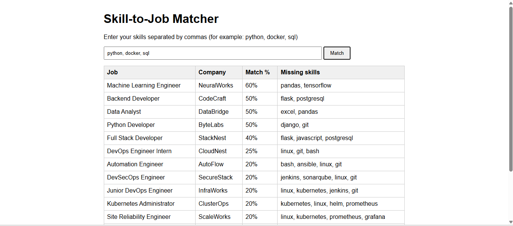
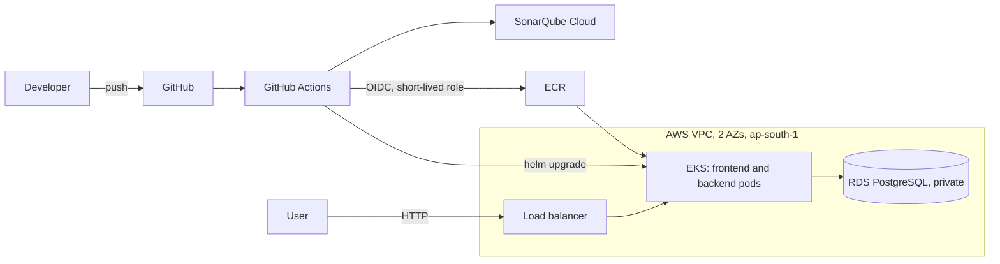
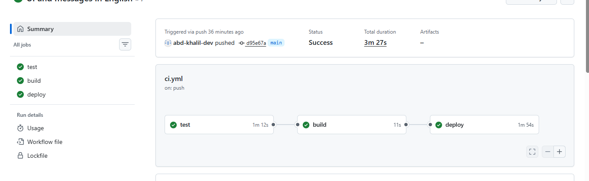
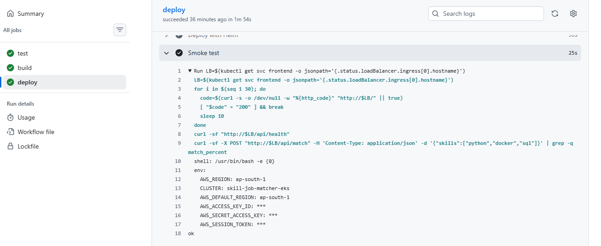
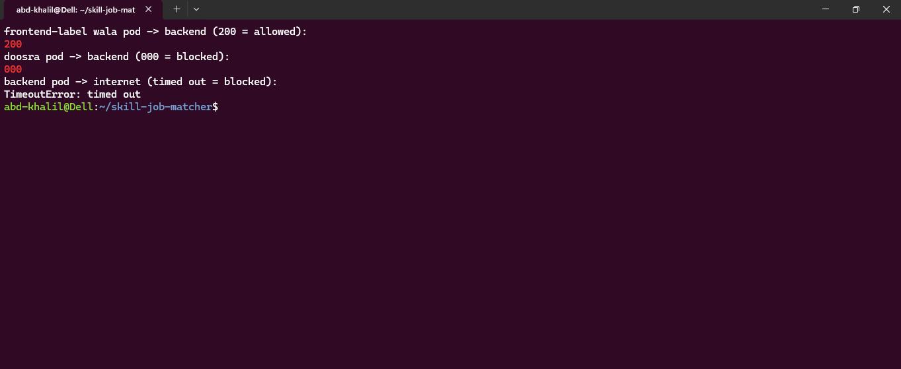
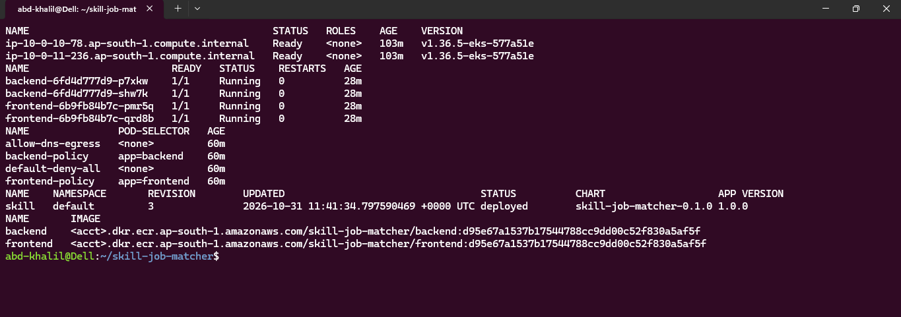
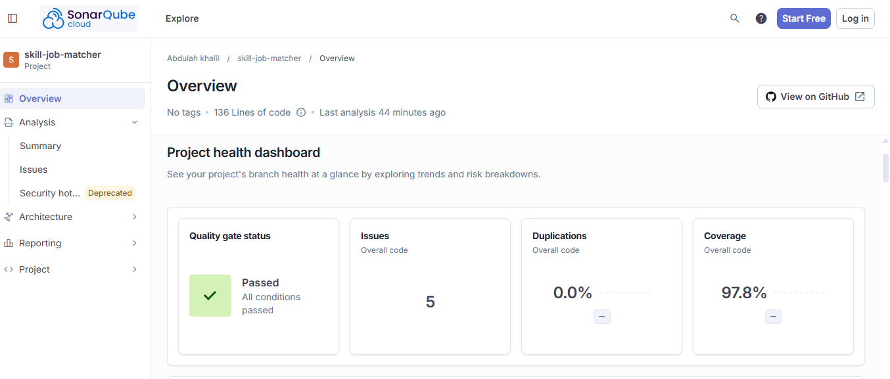
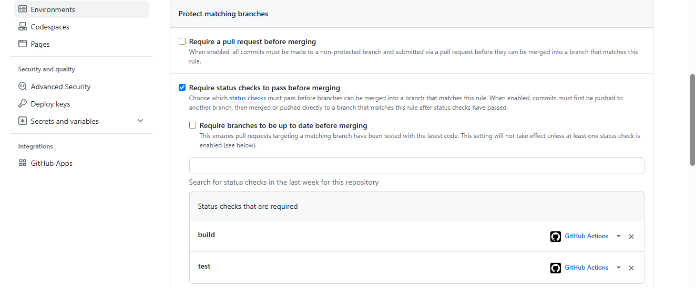

# Skill-to-Job Matcher

[](https://github.com/abd-khalil-dev/skill-job-matcher/actions/workflows/ci.yml)
[](https://sonarcloud.io/summary/new_code?id=abd-khalil-dev_skill-job-matcher)

A small web app that ranks jobs against the skills you enter and shows which skills you are still missing.
The app is deliberately simple. The point of this project is the platform around it: infrastructure as code,
a CI/CD pipeline with a code-quality gate, Kubernetes on AWS, and a network that is locked down by default.



## Architecture



- **Frontend**: static page served by nginx, which also reverse-proxies `/api/` to the backend.
- **Backend**: Flask API (`/health`, `/jobs`, `/match`) behind gunicorn, running as a non-root user.
- **Database**: PostgreSQL 16 (a container locally, RDS in AWS, in private subnets only).
- **Matching logic** lives in `backend/matcher.py`, separate from Flask and the database so it can be unit tested alone.

## Pipeline

Every push to `main` (and every pull request) runs `.github/workflows/ci.yml`:

| Stage | What it does |
|---|---|
| test | pytest with coverage (`backend/tests`) |
| scan | SonarQube Cloud analysis; the job fails if the quality gate fails |
| build | builds both Docker images |
| deploy | `main` only: pushes images to ECR (tag = commit SHA), `helm upgrade --install --wait`, then a smoke test against the live load balancer |

The deploy job first checks that the EKS cluster exists and skips itself otherwise, because the whole environment is destroyed when it is not in use.

## Infrastructure (Terraform)

| Path | Contents |
|---|---|
| `infra/bootstrap` | S3 state bucket (versioned, encrypted, public access blocked, native state locking), GitHub OIDC provider and the pipeline role. Never destroyed. |
| `infra/network.tf` | VPC, 2 public and 2 private subnets, internet gateway, one NAT gateway, route tables |
| `infra/ecr.tf` | 2 ECR repositories with scan-on-push and immutable tags |
| `infra/rds.tf` | PostgreSQL 16 in private subnets, encrypted storage, master password managed by RDS in Secrets Manager |
| `infra/eks.tf` | EKS 1.36 (community module), managed node group of 2 x t3.small in private subnets, access entry for the pipeline role, RDS ingress rule from the node security group only |

`scripts/up.sh` builds everything and loads the database password and schema into the cluster. `scripts/down.sh` removes the Helm release first (so the load balancer is deleted) and then destroys the stack.

## Security decisions

- **No long-lived AWS keys in GitHub.** The pipeline assumes an IAM role through OIDC. The trust policy only accepts tokens from this repository's `main` branch, and the role can only push to the project's ECR repositories, describe the cluster and the database, and (through an EKS access entry) edit the `default` namespace.
- **Database password never touches code or Git.** RDS generates it into Secrets Manager; `up.sh` pipes it straight into a Kubernetes Secret.
- **Network is closed by default.** Kubernetes NetworkPolicies deny all traffic, then allow only: DNS, internet to the frontend on port 80, frontend to backend on port 5000, and backend to the database subnets on port 5432. RDS also sits behind a security group that only accepts the node security group.
- **Verified, not assumed.** A test pod with the frontend label reaches the backend (200); any other pod times out; the backend and frontend cannot reach the internet while an unrestricted pod can.
- **Immutable image tags**: every image is tagged with the commit SHA, never `latest`.
- **SonarQube Cloud quality gate** is enforced in CI, and `main` has branch protection requiring the `test` and `build` checks.
- Containers run as non-root, and pods have resource requests and limits.

## Run it locally

```bash
cp .env.example .env        # then replace change_me with a password
docker compose up -d --build
```

Open http://localhost:8080. Run the tests with `cd backend && pip install -r requirements.txt pytest && python -m pytest`.

## Deploy to AWS

Prerequisites: AWS CLI configured, Terraform, kubectl and Helm.

1. Once: `cd infra/bootstrap && terraform init && terraform apply` (state bucket, OIDC provider, pipeline role).
2. In GitHub: add the repository variable `AWS_ROLE_ARN` (the role ARN printed by step 1) and the secret `SONAR_TOKEN`.
3. Create `infra/backend.hcl` containing `bucket = "<your state bucket>"` (it is git-ignored).
4. `./scripts/up.sh`, then run the `ci` workflow (push, or Run workflow in the Actions tab).
5. When finished: `./scripts/down.sh`.

Measured times: environment up TBD, pipeline run TBD, environment destroyed TBD.
The running environment costs roughly 0.3 USD per hour (estimate), so it is destroyed after every session.

## Screenshots

Pipeline run: test, build and deploy



Smoke test against the live load balancer



NetworkPolicy proof: the allowed pod gets 200, other pods time out, the backend cannot reach the internet



Cluster state



SonarQube Cloud quality gate



Branch protection on main



## Limitations and what I would do next

Being honest about what this project does not do:

- **HTTP only.** There is no domain, so no TLS. With a domain I would put an ALB or ingress with an ACM certificate in front.
- **One NAT gateway** (one AZ) to keep the bill down. Production would use one per AZ.
- **Kubernetes Secrets are only base64.** Production would use External Secrets Operator or the Secrets Store CSI driver.
- **Public EKS API endpoint** (IAM-protected) so it can be reached from a laptop and from GitHub-hosted runners.
- **Security scanning is SonarQube only.** There is no container image, secret or IaC scanner in the pipeline yet; ECR's basic scan on push is on but not a gate.
- **Actions are pinned to major versions**, not commit hashes.
- **Lab-sized**: 2 x t3.small nodes (the account's plan only allows Free Tier eligible instance types), no autoscaling, no monitoring stack yet.
- The human admin user has broad permissions; the pipeline role does not.

Planned: Prometheus and Grafana, a domain with TLS, Trivy and Checkov in the pipeline, Jenkins and Ansible versions of the setup.
